<!-- Perfil de Manoel · cartões em assets/ gerados pela skill perfil-github -->

 

  

**Coloco IA e automação no ponto da operação onde elas pagam e deixo a decisão com as pessoas.**

Para PMEs, agências, escritórios e empreendedores, do Brasil inteiro.

 

<picture>
  <source media="(max-width: 700px)" srcset="assets/papeis-celular.svg" />
  
</picture>

 

 

## 💼 Cases

<picture>
  <source media="(max-width: 700px)" srcset="assets/cases-celular.svg" />
  
</picture>

<b>📖 Problema, solução e resultado de cada case</b>

 

**🧠 Singular OS** · Singular TEC
- **Problema:** equipes querem usar agentes de IA no trabalho, mas as ferramentas vêm em inglês e agem sem pedir licença.
- **Solução:** um workspace de agentes em português, construído sobre um projeto aberto da Cloudflare, em que ações sensíveis esperam a aprovação de uma pessoa.
- **Resultado:** em produção desde setembro de 2026, com instância por cliente.
- **Meu papel:** adaptei o produto, mantenho o fork em dia com o projeto original e cuido da implantação.

**🏢 Equipe de IA** · Singular TEC
- **Problema:** uma empresa pequena precisa produzir conteúdo, prospectar e montar sites sem ter uma equipe para cada coisa.
- **Solução:** funcionários de IA por área (conteúdo, marketing, comercial, sites e recepção) que recebem pedidos no Telegram, trabalham e entregam uma prévia para eu aprovar antes de qualquer coisa ir ao ar.
- **Resultado:** 10 funcionários em 5 áreas, segundo o organograma interno de outubro de 2026.
- **Meu papel:** desenhei e construí do zero, e opero no dia a dia.

**🎬 Motion com IA** · Singular TEC
- **Problema:** vídeo curto de marca costuma levar dias de idas e vindas, e erros de texto ou contraste passam.
- **Solução:** um agente que propõe a ideia e o roteiro, faz o vídeo e o confere quadro a quadro, com travas que recusam número inventado, texto fora da margem e contraste baixo.
- **Meu papel:** criei o método e as ferramentas; a versão genérica vai virar código aberto.

**🧭 Kit de Produção** · Singular TEC
- **Problema:** trabalho feito com IA sai rápido, mas sem planejamento na medida e sem prova de que funciona.
- **Solução:** um método proporcional à tarefa: entender, planejar, executar, verificar com evidência e entregar, com revisão independente por outro modelo quando vale a pena.
- **Meu papel:** escrevi o método, que guia o trabalho da Singular com IA.

Fontes: o número de funcionários de IA vem do organograma interno da operação, de outubro de 2026.

 

## 🧠 Como eu trabalho

<picture>
  <source media="(max-width: 700px)" srcset="assets/metodo-celular.svg" />
  
</picture>

**Processo claro. Decisões humanas. Tecnologia no lugar certo.**

**Como eu trabalho com IA:**

<picture>
  <source media="(max-width: 700px)" srcset="assets/principios-celular.svg" />
  
</picture>

 

## 🛠️ Stack

 

 
 

 

## 📫 Vamos conversar

**Onde a sua operação perde tempo hoje?**

Me conta o gargalo e eu mostro um caminho possível.

 

